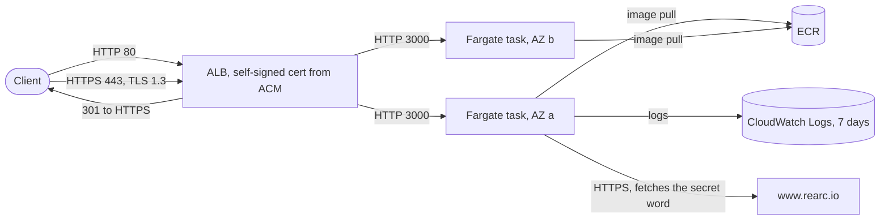

# Rearc quest: solution

The Quest app runs on **AWS ECS Fargate behind an Application Load Balancer with HTTPS**, deployed with
Terraform. **Five of the six checks pass. `/docker` fails on Fargate**; why, and what I would do about it,
is covered under [Findings](#findings) and [Given more time](#given-more-time-i-would-improve).

The vendor challenge text stays in [`README.md`](README.md). This file is the submission.

## Status

Live until 2026-10-27 (the `ttl` tag); I plan to tear it down on or after that date (see [Teardown](#teardown)).
Base URL: `https://quest-1405847154.us-east-1.elb.amazonaws.com`. The certificate is self-signed, so use
`curl -k` or accept the browser warning. Screenshots of every route are in [`docs/screenshots/`](docs/screenshots/).

**Try it** (needs only `curl` and this repository; the second command prints one PASS or FAIL row per route):

```
URL=https://quest-1405847154.us-east-1.elb.amazonaws.com
curl -k "$URL/"                  # the secret word
tests/smoke.sh -k "$URL"         # all six routes
```

Tasks 1 and 2 (a git repository, infrastructure as code) are done: GPG-signed commits on top of the vendor
history in a private repository, and Terraform with 31 resources in `infra/aws/`. The README's five checks,
plus `/aws`, which the app also serves:

| README check | Route | Result |
|---|---|---|
| Public cloud and index page | `/` | **Pass.** Shows the secret word, `NostraCulpa`. |
| (not in the README list) | `/aws` | **Pass.** "You are running in AWS, Detected: ECS,AWS". |
| Docker | `/docker` | **Fail on Fargate.** See Findings. Passes on a real Docker runtime (the local container). |
| Secret word | `/secret_word` | **Pass.** Prints the same word. |
| Load balancer | `/loadbalanced` | **Pass.** |
| TLS | `/tls` | **Pass.** |

Not done: a second cloud (extra credit) and a teardown run. See the end of this file.

## Architecture



- **Network:** one VPC, two public subnets in two AZs, an internet gateway, no NAT gateway. Tasks have public
  IPs so they can reach ECR, CloudWatch and `www.rearc.io`, but their security group accepts port 3000 only
  from the ALB's security group. The VPC's default security group has all rules removed.
- **TLS:** Terraform generates an RSA 2048 key and a 30-day self-signed certificate and imports it into ACM.
  The listener uses `ELBSecurityPolicy-TLS13-1-2-2021-06` (TLS 1.2 and 1.3). HTTP on port 80 redirects with a 301.
- **Compute:** ECS Fargate, 0.25 vCPU and 512 MiB per task, two tasks, x86-64 (the bundled binaries are
  x86-64 only). Tasks run as a non-root user with a read-only root filesystem and all Linux capabilities dropped.
  There is no task role, because the app calls no AWS APIs.
- **Image:** `node:24-slim` plus `ca-certificates` and `tini`, built for `linux/amd64`, tagged with the git
  SHA (never `latest`), stored in ECR with scan-on-push and a keep-5 lifecycle policy.
- **Health check:** `/tls`. `/` takes about 25 s outside a cloud, so it cannot be used.

## Repository layout

```
Dockerfile, .dockerignore   image (nothing cloud-specific)
src/, bin/, package*.json   the vendor app (src/ and bin/ are identical to the vendor repository)
infra/aws/                  Terraform module and the AWS Makefile
infra/aws/bootstrap/        one-time creation of the scoped IAM user that Terraform runs as
infra/contract.md           inputs and outputs any cloud root must provide
tests/smoke.sh              cloud-neutral acceptance test: base URL in, six checks out
Makefile                    same verbs on every cloud: build, smoke, plan, apply, destroy ...
.github/workflows/ci.yml    CI: Terraform fmt and validate, image build and local smoke test (checks only)
docs/adr/                   ten decision records
docs/PLAN.md                the plan, findings and a log of what I got wrong
docs/screenshots/           one screenshot per route
```

The only changes to the vendor app are `express` `~4.16.3` to `~4.22.3` in `package.json` (7 `npm audit` findings,
4 high, down to 0) and a new `package-lock.json`. `src/` and `bin/` are identical to the vendor repository.

## Deploying

Prerequisites: Docker with buildx, Terraform 1.9 or later (1.16.6 is pinned in `.tool-versions`),
AWS CLI 2.32 or later (for `aws login`), and an AWS account.

1. **Create the deploy identity (once, with admin credentials).** Terraform does not run as the root user.
   `infra/aws/bootstrap/bootstrap.sh` creates the IAM user `quest-deployer` from a scoped policy:
   `us-east-1` only, IAM limited to roles named `quest-*`, only two AWS-managed policies (ECS task execution
   and ECS-on-EC2 instance) may be attached, and privilege-escalation actions are denied. In the IAM console give that user a password and
   an MFA device, then:
   ```
   aws login --profile quest-deployer --region us-east-1
   ```
2. **Configure.** `cp infra/aws/terraform.tfvars.example infra/aws/terraform.tfvars` (gitignored) and
   optionally set `budget_email` and `ttl`.
3. **First deploy, without the secret word.**
   ```
   make apply        # builds the image, creates ECR, pushes, then applies the rest (about 3 minutes)
   make smoke        # six checks through the ALB
   ```
   The Makefile prints the AWS identity first and refuses to run as the root user. `AUTO_APPROVE=1` skips
   the Terraform confirmation.
4. **Read the word from the index page, set it, deploy again.** The word is not shown outside a cloud, so
   this takes two deploys. Put `secret_word = "..."` in `terraform.tfvars`, run `make apply`, then
   `EXPECT_SECRET_WORD=<word> make smoke`. Each rollout takes 3 to 4 minutes.
5. **Local checks, no AWS needed.** `make smoke-local` builds the image, runs it with the same restrictions as
   production, forges the headers an ALB would add, and runs the four checks that work outside a cloud
   (it skips `/` and `/aws`, which need a cloud).

### Teardown

```
make destroy        # shows the AWS identity, then Terraform asks for confirmation
make verify-clean   # lists anything still tagged project=quest, and queries each service; exits 1 if any is left
infra/aws/bootstrap/bootstrap.sh destroy   # optional: remove the deploy user and its policy
```

Sessions from `aws login` last up to 12 hours. If `make destroy` reports no AWS session, run
`aws login --profile quest-deployer --region us-east-1` first.

**I have not run `make destroy` yet.** `verify-clean` is tested against a clean account and against a stubbed
leftover, not against a real teardown. Terraform state is local and holds the TLS private key and the secret
word in plaintext, so it is gitignored and must stay on the machine.

## Findings

Things I learned by running the system, several of which contradicted what I expected.

1. **`/docker` fails on Fargate.** The `bin/003` binary tests only for the file `/.dockerenv`. Docker creates
   it; Fargate (containerd) does not. The same image passes `/docker` on a real Docker runtime, locally. The
   check's own message says "this might be OK as many cloud container orchestration platforms do not use
   Docker". I did not create `/.dockerenv` in the image to make it pass, because that would defeat the
   check. ECS on EC2 should pass, because a Docker runtime creates that file, but I did not try it. I decided
   against it (see ADR-0001) because it adds instances, an Auto Scaling group and an instance role for one route.
2. **`/` crashed on the first deploy.** `bin/001` is a Go program that fetches the secret word from
   `https://www.rearc.io/...` and verifies the certificate against the system CA store. `node:slim` ships
   none, so it panicked with `x509: certificate signed by unknown authority`. The fix is installing
   `ca-certificates`. My local smoke test could not have caught this, because outside a cloud `/` never
   reaches that call. Only the real deploy did.
3. **The secret word cannot be read locally.** Outside AWS, GCP or Azure the index page says so and prints no
   word. The flow is deploy, read the word, deploy again with it set.
4. **`/secret_word` echoes whatever `SECRET_WORD` holds.** It validates nothing, so a wrong value would still
   print. Compare it with the index page by eye (`EXPECT_SECRET_WORD` does this in the smoke test).
5. **What the checks look for** (found by running the container with forged headers, then confirmed on the
   real ALB): `/tls` passes when `X-Forwarded-Proto: https` is present; `/loadbalanced` passes with ALB-style
   headers including `X-Amzn-Trace-Id` and fails with `X-Forwarded-For` alone. I did not isolate which of
   the other headers matters.
6. **`/` and `/aws` take about 25 s outside a cloud** (cloud detection timing out) but 0.15 to 1.8 s on
   Fargate. The ALB health check therefore uses `/tls`.
7. **Node as PID 1 ignores SIGTERM.** `docker stop` took 10.4 s and ended in SIGKILL (exit 137). With `tini`
   it takes 0.1 s. Without the fix every ECS deploy would wait out the stop timeout.
8. **The app has a command-injection hole.** `src/000.js` builds shell commands from
   `JSON.stringify(req.headers)` with no escaping, so a header value containing `$(...)` runs a command. I
   confirmed it on the app running locally on my Mac with a harmless `touch`, and did not test it against the public
   deployment. I left the vendor app unmodified because the quest scores its behaviour, and contained the
   risk instead: non-root, read-only filesystem, no capabilities, no task role, ingress only from the ALB.
   That limits persistence and blast radius, not what injected code can do while it runs: it can read the
   task's environment (including `SECRET_WORD`) and, because egress is open, make outbound connections. The
   proper fix, `execFile` with an argument array, is the second item below.
9. **Security checks on the deployment:** neither task public IP answered on port 3000 within 6 s; HTTP
   returned 301 to HTTPS; the listener negotiated TLS 1.3 with the intended policy.
10. **CI caught a portability bug my local checks missed.** The first CI run failed at `terraform validate`:
    the provider lock file held checksums only for `darwin_arm64`, where I created it, and the runner is
    `linux_amd64`. My clean-clone check had passed because it ran on the same platform as the lock file. I
    reproduced the failure with a `linux/amd64` Terraform container, recorded checksums for four platforms, and
    the second run was green (both jobs, 22 and 34 s). Also, `/loadbalanced` takes 0.02 s on the runner
    against about 5 s on my Mac, so that delay is specific to my machine.

## Decisions

Ten ADRs in [`docs/adr/`](docs/adr/), each with the alternatives, tradeoffs, risks and mitigations. In
short: ECS Fargate over EC2, EKS and App Runner (0001); no database, because the app has none (0002, 0006);
public subnets without NAT, to avoid about $32 a month per NAT gateway ($0.045 an hour on the AWS pricing page, plus data processing) for a demo (0003); a Makefile and manual apply, with
a check-only CI workflow, instead of a deploy pipeline (0004); one feature group per verifiable route (0005); a `ttl` tag and a single
teardown command (0007); smallest Fargate size and a budget alert (0008); containment instead of patching the
vendor app (0009); and a portable contract with per-cloud roots, built only for AWS so far (0010).

`docs/PLAN.md` has the full plan, what was verified versus inferred, and a log of every claim I had to
correct.

## Cost

I estimate $1.5 to $2 a day in `us-east-1` for the ALB, two small tasks and four public IPv4 addresses. The
ALB and Fargate rates come from the AWS pricing pages; the IPv4 rate is from memory. **I have not measured
real spend**, because billing data lags. A budget alert emails at 80% of actual and 100% of forecast against
a $10 limit. It covers the whole account, because filtering by the `project` tag needs the tag activated as a
cost allocation tag, which takes about a day. Budgets alert but do not stop spend.

## Using AI

I used an AI coding assistant (Claude, `anthropic/claude-sonnet-5-5`, in the `omp` command-line agent) for
most of this. It read files, ran commands in my shell, wrote the code and the docs, and made the commits. I
chose between the options it laid out, for example keeping Fargate after `/docker` failed, using a scoped IAM
user instead of the root user, and bumping express, and I approved each `apply` and each `push`.

**Prompts (abridged, in order).** "Take a look at the README and come up with a plan to complete the
challenge." Then "Produce ADRs for: Compute, Database, Networking, CI/CD, Feature group identification,
Database seeding / replication, Teardown, Cost controls, Security", with Decision, Alternatives considered,
Tradeoffs, Risks and Mitigations for each. Then two review rounds, "Identify issues that AI may have missed or
gotten wrong" and "Is there anything else that was missed?", each followed by "Update the docs". Then "How
could we make this more cloud provider agnostic?", and step by step: the scoped identity, the repository and
signing setup, "Let's start on the terraform", the apply (with a budget email and a `ttl`), screenshots, this
file, doc fixes, the CI workflow, a pull request and its merge, and an accuracy review of this file.

**What it did well.** It inspected the six bundled binaries with `strings` before planning, which showed they
are cloud-aware and what `/docker` tests for. It ran experiments instead of guessing: forged headers against a
local container to learn what `/tls` and `/loadbalanced` read, a stop-time measurement that found the SIGTERM
problem, and an IAM policy simulator run (39 checks) before the first `apply`. It marked guesses as
`[INFERENCE]`, which let a later review find them.

**What it got wrong.** The first plan was wrong in several places, and it took two review rounds and the deploy
to catch them. The full list is the corrections log in `docs/PLAN.md`; the main ones:

- It said `aws` was configured (there was no session, and later it turned out to be the **root user**, which
  I replaced with a scoped IAM user), assumed a region was set, planned `npm ci` with no lockfile and
  `node:20` (end of life), and described the injection wrongly (a `'` in a header; the real vectors are
  `$(...)` and backticks).
- It chose Fargate with no caveat about `/docker`. A review turned that into an early test, which failed on
  the first deploy.
- It assumed `node:slim` has CA certificates (it does not, and only the deploy exposed it) and that task
  egress could be limited to port 443 (the binaries make their own outbound calls). It also suggested VPC flow
  logs to see those calls, though the deployer policy it later wrote could not create the role they need.
- Its pipeline simulation passed on my Mac and the real run failed: both used the same platform as the lock
  file, so only the runner exposed the missing `linux_amd64` checksums.
- Operational slips: a `set -e` stayed active in the shell and cut a test batch short, and it ran `gpg` from a
  non-interactive shell, which used one of the YubiKey's three PIN attempts before I cached the PIN. It
  stopped there instead of retrying.

**What I would not trust without checking:** anything in the ADRs marked `[INFERENCE]` that has no "verified"
note next to it, the cost figures, and Terraform argument names. The module passes `terraform validate`
and `plan`, and was applied successfully, but a plan is not proof of behaviour. The smoke test is.

## Given more time, I would improve

Three shortcomings matter most, and each has a reason:

- **`/docker` fails (5 of 6).** I chose not to run ECS on EC2 for one route, and not to fake `/.dockerenv`.
  The cost is one failed check.
- **The app's command injection is unfixed.** The quest scores the supplied app, so I contained the risk
  (non-root, read-only filesystem, no capabilities, ingress only from the ALB) instead of patching it. It is
  the worst problem in the repository.
- **The network and TLS posture is demo-grade.** Tasks have public IPs, egress is open and the certificate is
  self-signed, because NAT or endpoints cost money for a one-week demo, I had no domain, and I did not know
  what the binaries call outbound.

The full list, in rough order of value:

1. **Get to six of six on `/docker`.** Run the tasks on ECS on EC2 (a real Docker runtime), or add it behind
   a `compute` variable so both paths are demonstrable. It is more to operate (AMI, patching, capacity),
   which is why I did not do it for one route.
2. **Fix the command injection.** Replace `exec('bin/004 ' + JSON.stringify(req.headers))` with `execFile`
   and an argument array, or pass headers on stdin. I held back because the quest scores the supplied app,
   but in a real deployment this is the worst problem in the repository. Until then, a WAF rule that drops
   requests with `$(` or backticks in headers would reduce the exposure.
3. **Tighten egress.** Task egress is open. It must allow HTTPS to `www.rearc.io`, but beyond that I do not
   know what the binaries call. I would capture it with VPC flow logs (needs an admin to create the log role,
   which the scoped deployer cannot) and then allow only what is used.
4. **Private subnets.** Move tasks to private subnets with VPC endpoints for ECR, S3 and CloudWatch Logs (or
   NAT), so tasks have no public IPs. I skipped it to avoid fixed cost for a demo that lives a week.
5. **A real domain and an ACM-issued certificate.** The self-signed certificate means every client needs `-k`
   and nothing is verified end to end. A domain also lets me test whether `/loadbalanced` still passes with a
   non-`elb.amazonaws.com` host, which I only tested with a forged `localhost` host.
6. **A deploy pipeline.** CI checks only (format, validate, build, local smoke test) and never applies. I
   would add OIDC-based deploys with a protected environment and manual approval, so that applies do not
   depend on one person's laptop.
7. **Remote state with locking.** State is local and holds the TLS private key and the secret word in
   plaintext, and the word is also readable in the ECS task definition. I would use an encrypted S3 backend,
   and move the secret word to Secrets Manager. When I started, the S3 backend did not accept `aws login`
   credentials; that issue (hashicorp/terraform#37976) was closed as completed in January 2026, so it probably
   works now, but I did not retest it.
8. **Observability and resilience.** CloudWatch alarms on unhealthy targets and 5xx, ALB access logs, autoscaling,
   and deployment alarms. Today a failed task only shows in the ECS events.
9. **Cost.** Tag-based budget filtering, and check the real bill rather than my estimate.
10. **Supply chain.** Pin the base image by digest, add a scheduled `npm audit` and image scan, and move to
    Node 26 when it becomes LTS (28 October 2026 on the Node.js release schedule). Node 24, which the image
    uses, entered Maintenance LTS on 20 October 2026 and is supported until April 2028.
11. **A second cloud (extra credit).** `infra/contract.md` and the cloud-neutral smoke test exist for this, but
    the contract was drawn from one cloud and may need revising. The check binaries have separate success
    paths for GCP and Azure, so I would expect GCP (Cloud Run behind a load balancer) to be the quickest.
12. **Loose ends I know about:** I have not confirmed MFA is enabled on the `quest-deployer` user; its policy
    allows `ec2:*` in `us-east-1`, which is broader than the stack needs; I have not run a real teardown; and
    one combined build-and-test command hung for 300 seconds once and I could not reproduce it.
